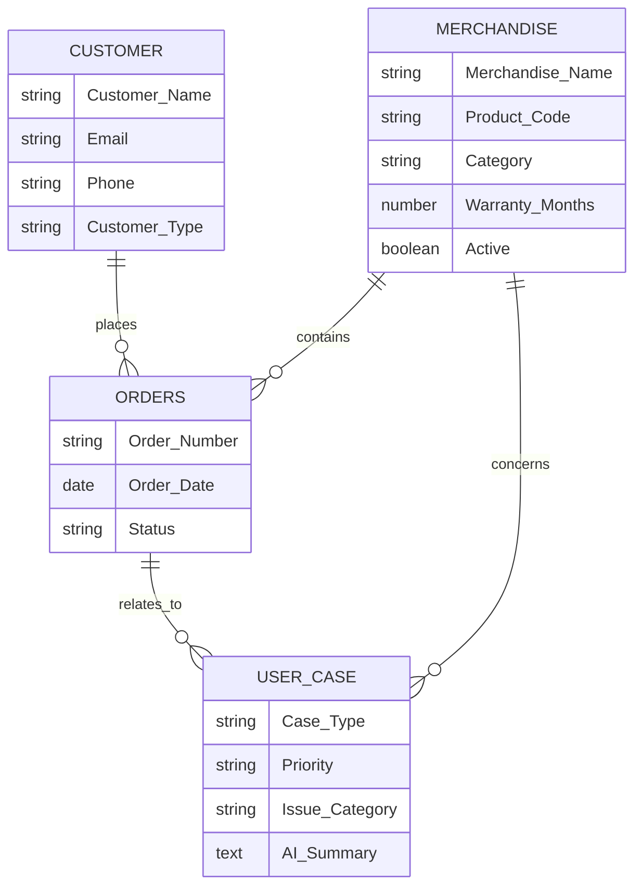

# Salesforce Data Model

This diagram shows the main objects and lookup relationships in the AI-Powered Customer Support & Service Automation project.

## Relationships

- **Customer → Orders:** Orders reference their associated customer.
- **Merchandise → Orders:** Orders reference the merchandise ordered.
- **Orders → User Case:** User Cases reference related orders.
- **Merchandise → User Case:** User Cases reference the affected product.

The diagram represents the intended relationships; the exact number of related records depends on the configured lookup fields and Salesforce data.
